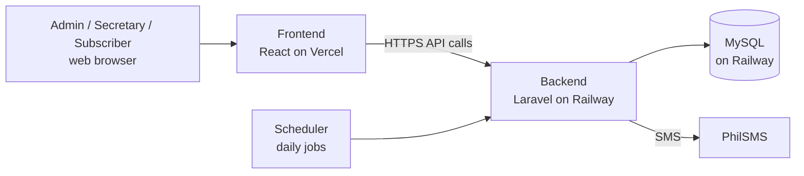

# SWIFT documentation

SWIFT is the subscription, billing and notification system for Jubal Brothers Cable TV Corporation, Palayan Branch. These pages describe how it is deployed and how it behaves. They were written from the code, so where something depends on a company decision or on settings that live outside the repository, the page says **To confirm**.

| Page | What it covers |
|---|---|
| [Deployment and releases](deployment.md) | Where the system runs, the two environments, how a change reaches production, settings, migrations and seeders, how to create the first admin, logs, rollback |
| [Automated jobs and SMS](automation.md) | The scheduled jobs, what triggers every SMS, time zone, how to confirm the scheduler runs |
| [Billing and payments](billing-and-payments.md) | How balances, months behind, advance credit and statuses are calculated; the payment workflow; what is not handled by the system |
| [Roles and permissions](roles-and-permissions.md) | What an admin, a secretary and a subscriber can do, per-secretary permissions, password confirmation, signing in |
| [Offline behaviour and errors](offline-and-errors.md) | What happens without a connection, the sign-in pause, and how errors and limits are shown |
| [Features added after the first evaluation](features.md) | Everything built in response to the evaluators and the chair panel: sign-in security, the subscriber's account page, the dashboard filter, report filters, payment methods, the audit trail, receipts and more |
| [Future improvements](future-improvements.md) | What was held back on purpose (forgot password, privacy policy, secure cookies, multi-factor) and ideas not started |
| [Glossary](glossary.md) | What each word on the screens means, and which one to use (service status, account status, availability, mobile number, balance...) |
| [Interface principles](ui-principles.md) | How clickable cards and buttons are made obvious, and the habits new screens should follow |
| [Flowcharts](flowcharts.md) | Registration and activation, recording a payment, status lifecycle, overdue accounts, advance payment and refund, release flow, signing in, confirming a password, verifying a mobile number |

## The system in one picture

| Part | Technology | Hosted on |
|---|---|---|
| Frontend | React, Vite, Tailwind, Driver.js (guided tours) | Vercel |
| Backend API | Laravel (PHP 8.3), Sanctum tokens | Railway |
| Database | MySQL | Railway |
| SMS | PhilSMS (Globe network only, see [Automated jobs and SMS](automation.md)) | PhilSMS |
